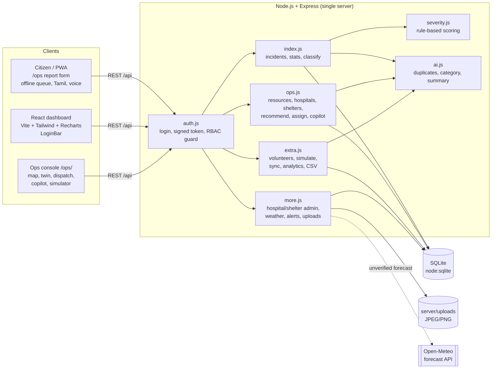
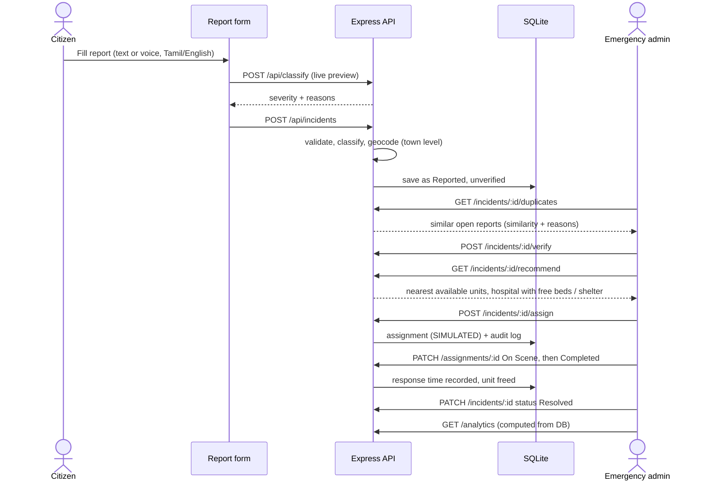
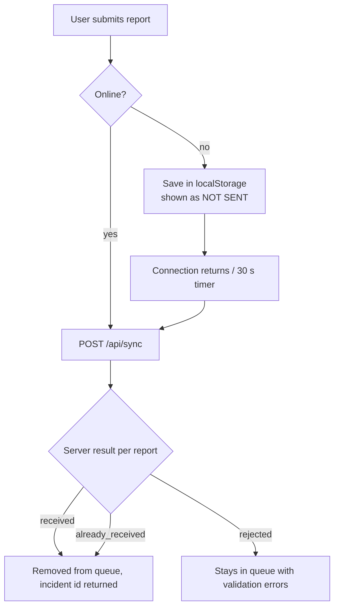
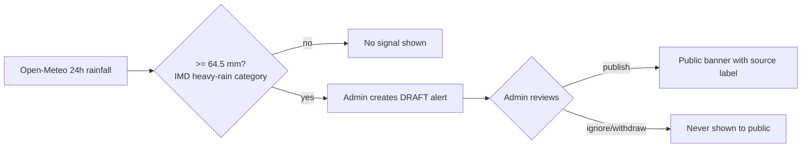
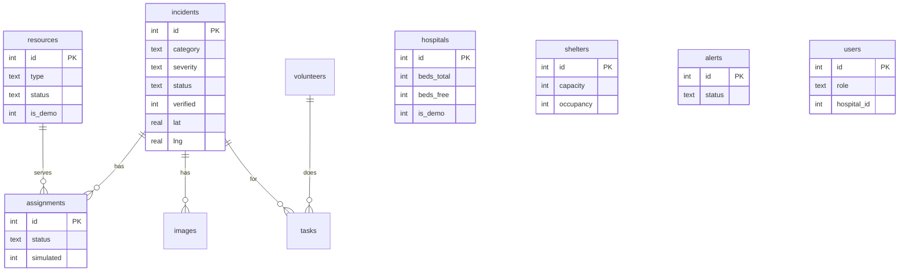

# Disaster360 AI: Emergency Response & Disaster Management Platform

Upgrade of the CODE CLASH 2026 Round 1 platform. Existing features (reporting, severity classification, dashboard, incident management) are unchanged; Disaster360 adds dispatch, hospitals, shelters, volunteers, early warning, a copilot, a simulator, offline sync, roles and analytics.

> **Honesty labels used everywhere:** `DEMO` = demonstration data (not live). `SIMULATED` = no real unit was alerted. `UNVERIFIED` = model forecast, not an official warning. `NOT SENT` = offline report saved only on the device.

## 1. Architecture

*(Diagrams use Mermaid and render on GitHub. PNG copies are in `docs/`: architecture, workflow, offline-sync, early-warning, data-model.)*



## 2. Main workflow (report to resolution)



## 3. Offline-first flow


Each report carries a `clientId`; the server stores a receipt so retries never create duplicates.

## 4. Early-warning flow (human in the loop)



## 5. Data model


Other tables: `audit_log`, `sync_receipts`.

## 6. Roles and access (when `AUTH_ENFORCE=true`)

| Capability | Super Admin | Emergency Admin | Rescue Team | Hospital Admin | Volunteer | Citizen |
|---|---|---|---|---|---|---|
| Submit report, view published alerts, volunteer sign-up | yes | yes | yes | yes | yes | yes |
| Edit/delete incidents, verify, assign, copilot, simulate, analytics | yes | yes | no | no | no | no |
| Map, resources, ops stats | yes | yes | yes | no | no | no |
| Update assignment status | yes | yes | yes | no | no | no |
| Hospital list / update beds | yes | yes | list only | own hospital only | no | no |
| Shelter list | yes | yes | yes | no | yes | no |
| Complete a task | yes | yes | no | no | yes | no |
| Create users, volunteers contact data, audit log | super admin (users); staff (others) | | | | | |

Passwords use scrypt; tokens are HMAC-signed and expire in 8 hours. Uploads are checked by file signature, limited to 2 MB, renamed randomly and viewable by staff only.

## 7. API summary (all under `/api`)

| Area | Endpoints |
|---|---|
| Incidents (original) | `GET/POST /incidents`, `GET/PATCH/DELETE /incidents/:id`, `GET /stats`, `POST /classify` |
| AI assistance | `POST /ai/analyze`, `GET /incidents/:id/duplicates`, `GET /incidents/:id/recommend` |
| Dispatch | `GET /resources`, `POST /incidents/:id/assign`, `PATCH /assignments/:id`, `POST /incidents/:id/verify`, `GET /ops/stats`, `GET /map` |
| Hospitals / shelters | `GET/POST /hospitals`, `PATCH /hospitals/:id`, `GET/POST /shelters`, `PATCH /shelters/:id` |
| Volunteers | `POST /volunteers`, `GET /volunteers`, `PATCH /volunteers/:id`, `POST /volunteers/:id/tasks`, `PATCH /tasks/:id` |
| Warning | `GET /weather`, `POST /alerts`, `PATCH /alerts/:id`, `GET /alerts`, `GET /alerts/all` |
| Other | `POST /copilot`, `POST /simulate`, `POST /sync`, `GET /analytics`, `GET /analytics/export.csv`, `GET /audit`, `POST /auth/login`, `POST /users`, `POST /incidents/:id/images`, `GET /incidents/:id/images`, `GET /images/:file` |

## 8. Implemented vs simulated vs not built

| Status | Features |
|---|---|
| Implemented (real logic) | Severity scoring, duplicate detection, category suggestion, resource recommendation, assignment and response-time tracking, verification, copilot (database answers only), analytics + CSV, volunteers with approval, hospital/shelter management, role-based access, audit log, offline queue + idempotent sync, Tamil/English labels, voice input, safe image upload, 2D twin, simulator |
| Demonstration data | Units, 3 hospitals, 2 shelters (`is_demo=1`; cleared per row once a real update is saved), approximate town-level incident coordinates |
| Simulated | Every dispatch (nobody is actually alerted); simulator scenarios use editable planning assumptions |
| Not built | AI image assessment, road-closure layer, historical heatmap, 3D twin, SMS/push notifications, full Tamil translation of the React dashboard |

## 9. Setup and run

Requires **Node.js 22.13+** (uses built-in `node:sqlite`).

```bash
npm install && npm --prefix client install && npm run build
PORT=3000 npm start
```
Open `http://localhost:3000` (React dashboard) and `http://localhost:3000/ops/` (ops console).

Secure mode:
```bash
AUTH_ENFORCE=true AUTH_SECRET=<long-random-string> SEED_ADMIN_PASSWORD=<password> PORT=3000 npm start
```
Log in as `admin`. Without `SEED_ADMIN_PASSWORD` a random password is printed once at first start. Without `AUTH_SECRET` tokens stop working after each restart.

| Variable | Purpose | Default |
|---|---|---|
| `PORT` | HTTP port | 5000 |
| `DB_FILE` | SQLite file path | `server/incidents.db` |
| `AUTH_ENFORCE` | Turn on role checks | off |
| `AUTH_SECRET` | Token signing key | random per start |
| `SEED_ADMIN_PASSWORD` | First super-admin password | random, printed |

**Deploy (Render or similar):** build command `npm install && npm --prefix client install && npm run build`, start command `npm start`, add the variables above, and attach a persistent disk for `DB_FILE` and `server/uploads/` (free tiers lose local files on restart).

## 10. Testing

Server logic was tested against real SQLite (permissions, validation, duplicate and sync idempotency, simulator writes nothing, upload checks) and the `/ops/` console in a headless browser with a mocked API. Not yet run against live Express, live Open-Meteo or real map tiles; do a quick smoke test after deploying.

**Live demo:** https://disaster360-ai.onrender.com
